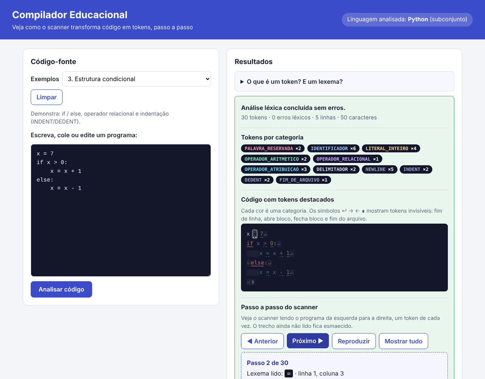

# Compilador Educacional

Software educacional web para o ensino de **análise léxica e análise sintática** de um subconjunto da linguagem **Python**, com visualização passo a passo voltada a estudantes de graduação em Ciência da Computação.

**Autora:** Maria Eduarda Almeida Lopes
**Disciplina:** Compiladores. Trabalho 3, terceira etapa: análise léxica (scanner).



Mais imagens: [passo a passo](docs/img/interface-passo-a-passo.png) · [erros léxicos](docs/img/interface-erros-lexicos.png) · [versão para celular](docs/img/interface-celular.png).

## Objetivo

Oferecer uma "porta de entrada" para o compilador educacional: o estudante escreve ou escolhe um programa, solicita a análise e **vê como o scanner (analisador léxico) o transforma em tokens**, com categorias, lexemas e posições (linha e coluna), destaque colorido, explicação passo a passo e erros léxicos didáticos.

**Estado atual:** a Etapa 3 implementa a **análise léxica**. **A análise sintática (Etapa 4) e a semântica ainda não foram implementadas**: um programa com tokens válidos, mas estrutura errada (ex.: `x = = 3 +`), é tokenizado normalmente.

Para quem está começando, veja o [tutorial](docs/tutorial.md).

## Linguagem escolhida e subconjunto

**Linguagem analisada:** Python (a mesma das etapas anteriores; a base foi preservada e ampliada).

**Por que Python:**

- é a linguagem de entrada em grande parte dos cursos de graduação, então o aluno já a conhece e pode focar no processo de compilação, e não na sintaxe;
- sua sintaxe é enxuta, o que ajuda a manter gramática e tokens pequenos;
- a indentação obriga o scanner a gerar tokens `NEWLINE`, `INDENT` e `DEDENT`, um caso real em que o léxico não se resume a separar palavras. A interface mostra esses tokens "invisíveis" de forma didática.

### Escopo léxico (resumo)

| Categoria | Exemplos |
| --- | --- |
| Palavras reservadas do subconjunto | `if`, `else`, `while` |
| Identificadores | `numero`, `resultado`, `_x1` (`[A-Za-z_][A-Za-z0-9_]*`) |
| Literais inteiros | `0`, `10`, `42` (sem zeros à esquerda) |
| Literais decimais | `3.14`, `0.5` |
| Operadores aritméticos | `+`, `-`, `*`, `/` |
| Operadores relacionais | `<`, `>`, `<=`, `>=`, `==`, `!=` |
| Atribuição | `=` |
| Delimitadores | `(`, `)`, `:` |
| Comentários | `# até o fim da linha` (ignorados) |
| Espaços em branco | ignorados no meio da linha; no início da linha geram `INDENT`/`DEDENT` |
| Quebra de linha | token `NEWLINE` (exceto em linhas vazias, só com comentário, ou dentro de parênteses) |
| Caracteres não reconhecidos | geram **erro léxico** com linha e coluna; o scanner continua |

A tabela completa (regras, mensagens de erro, o que **não** é reconhecido) está em [`docs/escopo-lexico.md`](docs/escopo-lexico.md).

Ficam para etapas posteriores: funções, listas, strings, classes e demais construções. Strings, por exemplo, geram erro léxico específico.

## Tecnologias

- **Frontend:** HTML, CSS e JavaScript puro (módulos ES), servido pelo **Nginx**. Não há framework nem etapa de build.
- **Backend:** **Python 3.12 + Flask**, executado com **Gunicorn**.
- **Scanner:** escrito em **Python puro**, dentro do backend (`backend/scanner.py`), sem bibliotecas externas.
  - *Justificativa:* o backend já é Python; um scanner artesanal (laço que lê caractere por caractere) é fácil de explicar e depurar em aula, e dispensa dependências novas no Docker. A indentação (pilha de níveis) e os erros com localização ficam sob controle total.
- **Orquestração:** Docker e Docker Compose.
- **Testes:** `pytest` (backend e scanner), `node:test` + `jsdom` (frontend), script de smoke test em Bash (implantação).

## Estrutura do repositório

```
.
├── backend/                  # API em Python (Flask + Gunicorn)
│   ├── app.py                # rotas e tratamento de erros
│   ├── validacao.py          # regras de validação da entrada
│   ├── scanner.py            # analisador léxico (Etapa 3)
│   ├── tests/                # testes do scanner, dos endpoints e das validações (pytest)
│   ├── requirements.txt
│   ├── requirements-dev.txt
│   └── Dockerfile
├── frontend/                 # Interface web estática servida pelo Nginx
│   ├── index.html            # estrutura da tela
│   ├── css/estilo.css        # estilos
│   ├── js/
│   │   ├── app.js            # ligação entre a tela e os módulos
│   │   ├── api.js            # comunicação com o backend
│   │   ├── validacao.js      # validação da entrada no navegador
│   │   ├── exemplos.js       # programas de exemplo
│   │   ├── tokens.js         # categorias, explicações e realce (funções puras)
│   │   └── resultado.js      # tabela, código colorido e passo a passo
│   ├── tests/                # testes de unidade, interface e integração
│   ├── package.json
│   ├── nginx.conf
│   └── Dockerfile
├── scripts/
│   ├── smoke_test.sh         # teste de implantação / ponta a ponta
│   └── testar_tudo.sh        # backend + frontend sem Docker
├── docs/
│   ├── escopo-lexico.md      # tabela completa do escopo léxico
│   ├── tutorial.md           # tutorial inicial para estudantes
│   ├── testes.md             # registro dos testes
│   └── img/                  # capturas de tela
├── config/                   # reservada para as próximas etapas
├── docker-compose.yml
├── .gitignore
├── .dockerignore
└── README.md
```

O frontend exibe a interface e encaminha as chamadas `/api/*` ao backend por meio do Nginx. O navegador só conversa com o Nginx (porta 8080); o nome `backend` é resolvido apenas dentro da rede do Docker Compose. Não há banco de dados e não foram criadas variáveis de ambiente, portas nem dependências novas nesta etapa.

## Pré-requisitos

- [Docker](https://docs.docker.com/get-docker/) 24 ou superior
- Docker Compose v2 (plugin `docker compose`, já incluído no Docker Desktop e nas versões recentes do Docker Engine)
- Porta **8080** livre na máquina

Para conferir as versões:

```bash
docker --version
docker compose version
```

## Como executar

Clone o repositório e, na raiz dele, suba os contêineres:

```bash
git clone https://github.com/Duda1222/Compiladores
cd Compiladores
docker compose up --build -d
```

Depois abra no navegador: <http://localhost:8080>.

## Como encerrar

```bash
docker compose down
```

Para remover também as imagens construídas:

```bash
docker compose down --rmi local
```

## Como usar a interface

1. **Escolher um exemplo (opcional):** são nove, de atribuições simples a blocos aninhados e a um programa com erros léxicos.
2. **Escrever ou editar o código** no editor.
3. **Analisar:** clique em **Analisar código**. A área **Resultados** mostra, nesta ordem:
   - resumo (tokens, erros, linhas, caracteres);
   - **erros léxicos** (se houver), com linha, coluna e mensagem, e **avisos**;
   - **tokens por categoria** (contagem);
   - **código com tokens destacados** (uma cor e um estilo de sublinhado por categoria; `↵ → ← ∎` mostram os tokens invisíveis);
   - **passo a passo**: *Próximo*, *Anterior*, *Reproduzir*/*Pausar* e *Mostrar tudo*; cada passo explica por que o lexema virou aquele token, e o que ainda não foi lido fica esmaecido;
   - **sequência de tokens** (o código original "vira" esta lista) e **tabela de tokens** (`#`, tipo, lexema, linha, coluna).
4. O bloco "O que é um token? E um lexema?" explica os conceitos na própria tela.
5. **Mensagens de entrada** (vazio, só espaços, falha de comunicação, erro inesperado) continuam como na Etapa 2.

O layout é responsivo (usa uma coluna em telas estreitas, a tabela rola para os lados e os botões têm área de toque confortável), então pode ser aberto no navegador do celular. Não é um aplicativo móvel nativo.

O código **não é presumido válido**: um programa com erros é aceito e analisado normalmente.

## Exemplos de programas disponíveis

| # | Exemplo | O que demonstra |
| --- | --- | --- |
| 1 | Atribuição e literais | identificadores, inteiros e decimais |
| 2 | Expressões aritméticas | `+ - * /` e parênteses |
| 3 | Estrutura condicional | `if`/`else`, relacional, `INDENT`/`DEDENT` |
| 4 | Estrutura de repetição | `while`, `!=` |
| 5 | Com erro intencional | tokens válidos em estrutura errada (será tema do parser) |
| 6 | Todos os operadores | aritméticos, atribuição e os seis relacionais |
| 7 | Comentários e linhas em branco | ignorados pelo scanner |
| 8 | Blocos aninhados | vários `INDENT`/`DEDENT` |
| 9 | Com erros léxicos | `@`, `3.14.15`, `12abc`, string e `def` (aviso) |

Os textos exatos estão em `frontend/js/exemplos.js`.

## Comunicação frontend ↔ backend

**Requisição**

```
POST /api/analisar
Content-Type: application/json

{ "codigo": "numero = 10\n" }
```

**Resposta (HTTP 200)** — também quando há erros léxicos: o pedido foi processado e o campo `sucesso` diz se a análise léxica passou.

```json
{
  "recebido": true,
  "sucesso": true,
  "mensagem": "Análise léxica concluída sem erros.",
  "linhas": 1,
  "caracteres": 12,
  "tokens": [
    { "tipo": "IDENTIFICADOR",       "lexema": "numero", "linha": 1, "coluna": 1 },
    { "tipo": "OPERADOR_ATRIBUICAO", "lexema": "=",      "linha": 1, "coluna": 8 },
    { "tipo": "LITERAL_INTEIRO",     "lexema": "10",     "linha": 1, "coluna": 10 },
    { "tipo": "NEWLINE",             "lexema": "\n",     "linha": 1, "coluna": 12 },
    { "tipo": "FIM_DE_ARQUIVO",      "lexema": "",       "linha": 2, "coluna": 1 }
  ],
  "erros": [],
  "avisos": [],
  "resumo": { "total_tokens": 5, "total_erros": 0, "erros_omitidos": 0,
              "por_tipo": { "IDENTIFICADOR": 1, "OPERADOR_ATRIBUICAO": 1, "LITERAL_INTEIRO": 1, "NEWLINE": 1, "FIM_DE_ARQUIVO": 1 } }
}
```

**Com erro léxico** (`x = 10 @ 2`): `"sucesso": false`, `"mensagem": "Análise léxica concluída com 1 erro léxico."` e

```json
"erros": [
  { "tipo": "ERRO_LEXICO", "lexema": "@", "linha": 1, "coluna": 8,
    "mensagem": "Caractere não reconhecido: '@'. Ele existe em Python, mas ainda não faz parte do subconjunto suportado." }
]
```

A interface exibe: *"Linha 1, coluna 8 — Caractere não reconhecido: '@'..."*. Os tokens válidos continuam na lista (o scanner não para no primeiro erro).

| Campo | Descrição |
| --- | --- |
| `recebido` | `true` se o pedido foi aceito e processado (mantido da Etapa 2) |
| `sucesso` | `true` se não houve erro léxico (avisos não contam como erro) |
| `tokens[]` | `tipo`, `lexema`, `linha`, `coluna`. Tipos em [`docs/escopo-lexico.md`](docs/escopo-lexico.md) |
| `erros[]` | `tipo` = `ERRO_LEXICO`, `lexema`, `linha`, `coluna`, `mensagem` (máx. 200 itens) |
| `avisos[]` | `tipo` = `AVISO_FORA_DO_ESCOPO`, mesmos campos |
| `resumo` | totais e contagem `por_tipo`; `erros_omitidos` > 0 quando passou de 200 erros |
| `linhas`, `caracteres` | tamanho do texto enviado |

**Respostas de erro de entrada** (inalteradas desde a Etapa 2)

```json
{ "recebido": false, "erro": "entrada_vazia", "mensagem": "Informe um código-fonte antes de solicitar a análise." }
```

| Situação | HTTP | `erro` |
| --- | --- | --- |
| Corpo ausente, malformado, sem `Content-Type: application/json` ou que não é um objeto | 400 | `corpo_invalido` |
| Campo `codigo` ausente | 400 | `campo_ausente` |
| Campo `codigo` que não é texto | 400 | `campo_invalido` |
| Texto vazio | 422 | `entrada_vazia` |
| Somente espaços em branco | 422 | `entrada_somente_espacos` |
| Código acima de 100.000 caracteres | 413 | `entrada_muito_grande` |
| Rota inexistente ou método não permitido | 404 / 405 | `requisicao_invalida` |
| Erro inesperado no servidor | 500 | `erro_interno` (mensagem genérica; detalhes só no log) |

Também existem `GET /api/health` (`{"status":"ok"}`, usado pelo healthcheck do Compose) e `GET /api/hello` (mantido da Etapa 1).

A validação ocorre **nos dois lados**. O scanner nunca expõe stack traces: qualquer falha inesperada vira `erro_interno` genérico.

### Exemplos de entrada e saída do scanner

| Entrada | Saída (tipo:lexema) |
| --- | --- |
| `x = 10` | `IDENTIFICADOR:x` `OPERADOR_ATRIBUICAO:=` `LITERAL_INTEIRO:10` `NEWLINE` `FIM_DE_ARQUIVO` |
| `a <= b` | `IDENTIFICADOR:a` `OPERADOR_RELACIONAL:<=` `IDENTIFICADOR:b` ... |
| `if x:`⏎`····y = 1` | `PALAVRA_RESERVADA:if` `IDENTIFICADOR:x` `DELIMITADOR::` `NEWLINE` `INDENT` `IDENTIFICADOR:y` ... `DEDENT` `FIM_DE_ARQUIVO` |
| `x = 3.14.15` | erro léxico: *Literal numérico malformado '3.14.15': literal com mais de um ponto decimal.* |
| `# só comentário` | apenas `FIM_DE_ARQUIVO` |

## Testes

Instalação das dependências de teste e execução (sem Docker):

```bash
./scripts/testar_tudo.sh
```

Ou separadamente:

```bash
# backend: scanner, endpoints, validação
cd backend
pip install -r requirements-dev.txt
python -m pytest -q
python -m pytest -q tests/test_scanner.py     # só o scanner

# frontend: unitários, interface (jsdom) e regressão
cd frontend
npm install
npm test

# integração frontend <-> backend real (com o backend em execução na porta 5000)
BACKEND_URL=http://localhost:5000 npm test
```

As respostas usadas nos testes do frontend são geradas pelo **scanner real** (`python tests/gerar_fixtures.py`, na pasta `backend`) e um teste do backend avisa se elas ficarem desatualizadas, garantindo que frontend e backend usem o mesmo contrato.

Teste de implantação (com a aplicação de pé via Docker Compose):

```bash
docker compose up --build -d
./scripts/smoke_test.sh
```

**Resultados relevantes** (detalhes, falhas corrigidas e pendências em [`docs/testes.md`](docs/testes.md)):

- backend: **188** testes aprovados, 0 reprovados (125 do scanner, 40 de endpoints, 22 de validação, 1 de fixtures);
- frontend: **124** aprovados, 0 reprovados (7 de integração ignorados sem `BACKEND_URL`);
- integração frontend ↔ backend real: **131** aprovados, 0 reprovados;
- regressão das Etapas 1 e 2: todos os testes anteriores continuam passando (um teste foi atualizado porque a mensagem de sucesso mudou de propósito);
- smoke test: **24** verificações aprovadas contra uma emulação do Nginx; a execução com o Docker Compose real está registrada como **pendente** em `docs/testes.md`.

## Solução de problemas

- **Porta 8080 em uso:** altere o mapeamento em `docker-compose.yml` (por exemplo `"8081:80"`) e acesse a nova porta (`BASE_URL=http://localhost:8081 ./scripts/smoke_test.sh`).
- **Ver logs:** `docker compose logs -f`.
- **Reconstruir do zero:** `docker compose down --rmi local && docker compose up --build -d`.

## Limitações conhecidas

- O backend executa **apenas a análise léxica**. Não há análise sintática (**Etapa 4**) nem semântica: `x = = 3 +` é tokenizado sem erro, pois cada token é válido.
- Parênteses desbalanceados e blocos mal formados são problemas do parser, não do scanner.
- Strings, listas, vírgula, ponto e vírgula, `%`, `**`, `//`, `+=`, identificadores com acento e continuação de linha com `\` **não** são reconhecidos (geram erro léxico).
- Tabulação na indentação é rejeitada (use espaços).
- O editor é um campo de texto simples, sem realce em tempo real nem numeração de linhas.
- O limite de entrada é de 100.000 caracteres; a lista de erros é limitada a 200 itens.
- Não há teste automatizado em navegador real (a interface é testada em jsdom; a conferência visual foi feita manualmente em um navegador, no desktop e em tela de celular).
- Não é um aplicativo móvel; apenas a página web é responsiva.

## Próximas etapas

**Etapa 4:** análise sintática (gramática, FIRST/FOLLOW, tabela preditiva e árvore de derivação), consumindo a lista de tokens que o scanner já entrega. Depois, análise semântica e visualização passo a passo das fases seguintes.

