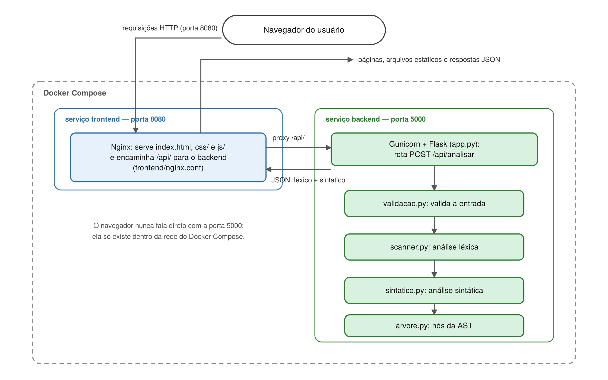
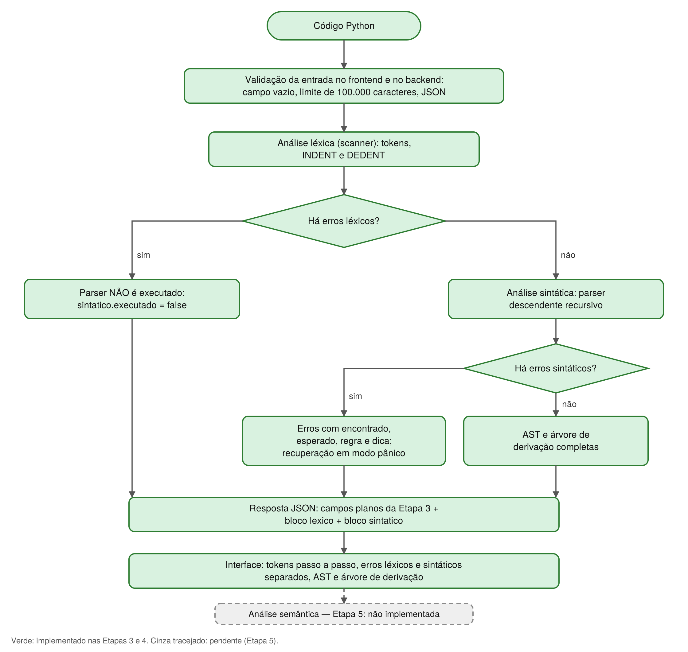

# Materiais e Métodos: proposta, fluxograma e plano de avaliação (Etapa 4)

Resumo do texto entregue na tarefa acadêmica da Etapa 4, mantido no repositório para consulta. Autora: Maria Eduarda Almeida Lopes.

## Arquitetura

Fonte: [`arquitetura.py`](arquitetura.py) (gera `img/arquitetura.png`). O navegador fala só com o Nginx (porta 8080); `/api/` é encaminhado ao Flask/Gunicorn (porta 5000), que executa validação, scanner e parser.

## Fluxograma

Fonte: [`fluxo-sistema.py`](fluxo-sistema.py) (gera `img/fluxo-sistema.png`). Verde: implementado. Cinza tracejado: pendente (análise semântica, Etapa 5).

- **Decisão 1 (erros léxicos):** se existirem, o parser **não** é executado; a resposta traz `sintatico.executado = false` e só os erros léxicos. Motivo: tokens inválidos gerariam erros sintáticos em cascata.
- **Decisão 2 (erros sintáticos):** o parser devolve `sintatico.erros[]` (encontrado, esperado, regra, dica) e `ast = null`; sem erros, devolve AST e árvore de derivação.
- Erros léxicos (`lexico.erros`) e sintáticos (`sintatico.erros`) voltam em campos separados.
- A validação de entrada ocorre no frontend e de novo no backend.

## Contrato

Ver [`README.md`](../README.md) (seção "Contrato da análise sintática") e [`ast.md`](ast.md). A resposta preserva os campos planos da Etapa 3 e acrescenta os blocos `lexico` e `sintatico`.

## Casos de teste e avaliação

- Casos de teste: [`casos-de-teste.md`](casos-de-teste.md).
- Testes automatizados: `cd backend && python -m pytest`; `cd frontend && npm test`; `docker compose up --build -d && ./scripts/smoke_test.sh`.
- Última execução (18/11/2026, clone limpo): backend 668 aprovados e 2 ignorados; frontend 181 aprovados com o backend real; smoke test 33 de 33. Ressalva em [`testes.md`](testes.md): o `docker compose up --build` ainda precisa ser rodado numa máquina com acesso ao Docker Hub.
- Questionário da avaliação por pares, pronto para copiar: [`questionario-avaliacao.md`](questionario-avaliacao.md).
- Avaliação por pares: questionário Likert (1 a 5) aplicado a estudantes que cursam ou já cursaram Compiladores, anônimo e voluntário. Mede **percepção** de clareza e utilidade, não aprendizagem.

## Diferencial pretendido (sem afirmar ineditismo)

Python com `INDENT`/`DEDENT`; AST e árvore de derivação lado a lado; erros sintáticos com encontrado/esperado/regra/dica; execução por Docker Compose. Nas fontes lidas nenhuma analisa Python; isso não prova que não existam outras. Não são diferenciais: construção animada da árvore e recolher/expandir (já presentes no VAST).

## Limitações

Sem análise semântica; recuperação de erros simples; sem animação da árvore; sem avaliação com estudantes até o momento; execução completa do Docker Compose desta etapa ainda não validada em máquina limpa.
