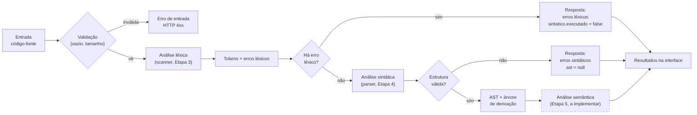

# Análise sintática: estratégia, decisões e erros (Etapa 4)

Este documento registra **o que foi decidido, por quê e como foi verificado**. Serve de base para a seção de Materiais e Métodos do artigo.

## 1. Fluxo



Código-fonte de `docs/fluxo.mmd` (Mermaid). A etapa tracejada (semântica) **ainda não existe**: é a Etapa 5.

Em código (`backend/app.py`): `POST /api/analisar` → `validar_corpo` → `analisar_lexico` → (se não houver erro léxico) `analisar_sintatico` → resposta JSON. O frontend envia o código, recebe o JSON e desenha as seções léxica e sintática.

## 2. Estratégia escolhida: descendente recursivo preditivo

| Opção | Vantagem | Por que não (ou sim) |
| --- | --- | --- |
| **Descendente recursivo (escolhida)** | Cada regra da gramática vira uma função com o mesmo nome; o código lê como a gramática; fácil de explicar em aula e de depurar; erros específicos por regra são triviais de produzir; sem dependências | A gramática precisa estar sem recursão à esquerda (resolvido com laços `{ }`) |
| LL(1) por tabela | Mostra FIRST/FOLLOW explicitamente | Mais indireto de ler, e mensagens de erro específicas são mais difíceis |
| LR / geradores (ANTLR, Lark) | Poderosos para linguagens grandes | Escondem o algoritmo, que é justamente o que se quer ensinar; adicionam dependência no Docker |

Detalhes:

- Cada não terminal é um método de `Parser` (`_soma`, `_termo`, `_bloco`...).
- A precedência vem da **forma** da gramática; a associatividade à esquerda, dos laços `while` em `_soma` e `_termo`.
- O parser reusa o scanner da Etapa 3 sem alterá-lo: recebe `list[Token]`.
- Um único ponto usa 2 tokens de olhada (`IDENTIFICADOR` + `=`), documentado em [`gramatica.md`](gramatica.md), seção 5.
- O parser **nunca lança exceção** para entradas inválidas: erros viram objetos `ErroSintatico` registrados e a análise continua.

## 3. Decisão: erros léxicos e o parser

**Se houver qualquer erro léxico, o parser não é executado.**

Motivos:

1. O scanner descarta o trecho inválido e continua; a lista de tokens fica **com buracos**. Um parser rodando nela produziria erros sintáticos que são só consequência do buraco (`x = 10 @ 2` viraria "operador faltando"), enganando o estudante.
2. É a ordem natural das fases: o erro mais básico primeiro.
3. É a recomendação do enunciado.

Como é comunicado: a resposta traz `sintatico.executado = false`, `sucesso = false`, `ast = null`, `erros = []` e uma `mensagem`; a interface exibe a seção **"Análise sintática não executada"** explicando o motivo, e os erros léxicos continuam listados. Está coberto por testes de backend (`test_erro_lexico_nao_executa_o_parser`, `test_erro_lexico_e_sintatico_juntos_mostram_so_o_lexico`) e de interface (`erro léxico: parser não executado...`).

Consequência a conhecer: se o programa tem um erro léxico **e** um sintático, só o léxico aparece até ser corrigido.

## 4. Contrato da resposta

```json
{
  "recebido": true, "mensagem": "...", "linhas": 3, "caracteres": 40,
  "sucesso": true, "tokens": [...], "erros": [], "avisos": [], "resumo": {...},   // campos da Etapa 3, mantidos
  "lexico":    { "sucesso": true, "tokens": [...], "erros": [], "avisos": [], "resumo": {...} },
  "sintatico": {
    "executado": true,
    "sucesso": true,
    "ast": { "tipo": "Programa", "...": "..." },      // ou null
    "derivacao": { "simbolo": "programa", "...": "..." },   // ou null
    "erros": [ { "tipo": "ERRO_SINTATICO", "linha": 1, "coluna": 9, "encontrado": "fim da linha",
                 "esperado": ["identificador", "número", "'('", "'-'", "'+'"],
                 "mensagem": "...", "regra": "...", "dica": "..." } ],
    "mensagem": "Análise sintática concluída sem erros.",
    "resumo": { "total_erros": 0, "erros_omitidos": 0, "total_nos": 6, "altura": 4, "por_tipo": {...} }
  }
}
```

- `lexico` repete os campos planos da Etapa 3 (que continuam na raiz, para **não quebrar** nada que já dependia deles; há teste de regressão). O campo `mensagem` da raiz continua sendo o da análise léxica.
- `sintatico.erros[]`: os campos exigidos são `tipo`, `linha`, `coluna`, `encontrado`, `esperado` e `mensagem`; `regra` (regra da gramática violada) e `dica` são extras opcionais.
- `encontrado` é o lexema, ou `fim da linha`, `fim do arquivo`, `indentação`, `fim do bloco` para tokens estruturais.
- HTTP: sempre **200** quando o pedido foi processado, inclusive com erros léxicos ou sintáticos (como na Etapa 3). Entrada vazia (422), grande demais (413), corpo inválido (400): inalterado desde a Etapa 2.
- Posições de erro no fim do arquivo apontam para o fim da última linha com código, e não para uma linha inexistente.

## 5. Tratamento de erros sintáticos

### Mensagens didáticas

Cada situação do enunciado tem mensagem própria (todas testadas):

| Situação | Exemplo | O que o estudante lê (resumo) |
| --- | --- | --- |
| Token inesperado | `x = 1 + * 2` | "Operadores consecutivos: '+' seguido de '*'. Falta um operando entre eles." |
| Construção incompleta | `x = 10 +` | "A expressão termina em '+', mas falta o operando à direita dele" |
| Falta `)` | `y = (3 * 4` | "O parêntese '(' aberto na linha 1, coluna 5 não foi fechado: esperava ')'." |
| `)` sobrando | `x = 3)` | "Parêntese ')' sem o '(' correspondente." |
| Falta `:` | `if x > 0` | "Faltou o ':' no fim da linha do 'if' (linha 1)." |
| Falta bloco | `if x:` + linha sem recuo | "Esperava um bloco indentado depois do ':' do 'if'..." |
| Fim do arquivo inesperado | `if x:` (fim) | "Fim do arquivo inesperado: o 'if' da linha 1 precisa de um bloco indentado." |
| `else` sem `if` | `else:` | "'else' sem um 'if' correspondente..." |
| Operadores consecutivos / `=` por `==` | `x = = 3`, `if x = 3:` | menciona `==` na dica |
| Palavra reservada onde cabe identificador | `if = 3`, `def f` | "A palavra reservada 'if' não pode ser usada como nome de variável" |
| Falta operador | `x 5` | "Faltou um operador (ou o fim da linha) entre o identificador 'x' e o número '5'." |
| Construção fora do subconjunto | `a < b < c`, `a = b = 1`, `elif` | explica o que não é suportado e sugere alternativa |

Toda mensagem traz **linha, coluna, o que foi encontrado, o que era esperado** e, quando útil, **a regra da gramática violada** e uma dica. Nenhuma expõe stack trace, caminho de arquivo ou detalhe interno (teste `test_mensagens_nao_vazam_detalhes_internos`; falhas inesperadas do servidor viram `erro_interno` genérico, como na Etapa 2).

### Recuperação (modo pânico)

Depois de um erro, o parser:

1. registra o erro;
2. descarta tokens até o fim da linha (`NEWLINE`) e, se a linha abria um bloco, descarta também o bloco indentado inteiro (um `INDENT` até o `DEDENT` correspondente);
3. continua no próximo comando.

Para **evitar erros em cascata**:

- um `else` que sobra depois de um `if` com erro no cabeçalho é descartado em silêncio (`if x = 3:` gera 1 erro, não 2);
- erros na **mesma posição** não se repetem;
- o limite é de **20 erros listados** (a contagem total fica exata e a interface informa quantos foram omitidos);
- há uma garantia de progresso (se um erro não consumiu token, o parser avança um), então **a análise sempre termina** (teste com 800 entradas aleatórias).

Limitação honesta: a recuperação é simples. Descartar "o resto da linha" pode esconder um segundo erro na mesma linha; por isso a interface orienta a **corrigir sempre o primeiro erro** e reenviar.

## 6. Limites de proteção

Entradas de até 100.000 caracteres são aceitas (limite da Etapa 2). Para que entradas patológicas não travem o servidor nem a tela:

| Limite | Valor | Ao exceder |
| --- | --- | --- |
| Parênteses aninhados | 25 | erro sintático amigável |
| Blocos aninhados | 25 | erro sintático amigável |
| Altura da AST | 150 níveis | erro sintático amigável |
| Erros listados | 20 | omite os demais e informa a contagem |

`RecursionError` do Python é capturado como última defesa. Teste `test_entradas_hostis_nao_derrubam_o_servidor`.

## 7. O que ficou de fora (decisões registradas)

| Item | Decisão |
| --- | --- |
| Diferencial: construção **passo a passo/animada** da árvore | **Não implementado.** Foram priorizados: árvore expansível/recolhível, realce do trecho de código, filtro por tipo, exportação JSON, regra por nó e a árvore de derivação ao lado da AST. O passo a passo da Etapa 3 (tokens) foi mantido. |
| Grafo/SVG da árvore | Não implementado: a árvore é uma lista aninhada acessível (navegável por teclado, funciona com leitor de tela, não depende de cor). |
| Diferencial opcional: **Ollama + Llama 3.2** | **Não implementado.** Exige um serviço pesado no Docker Compose e o download de um modelo; não foi possível validá-lo nesta etapa, e o enunciado o trata como opcional. |
| Nós `Funcao`, `ChamadaFuncao`, `Retorno` | Não existem: a linguagem escolhida não tem funções (ver [`ast.md`](ast.md)). |
| Semântica (variável usada sem atribuição, tipos) | Etapa 5. O parser aceita `y = x + 1` mesmo que `x` nunca tenha sido definido. |

## 8. Acessibilidade e usabilidade da árvore

- A árvore é uma lista aninhada com `role="tree"`; cada nó tem botão de recolher/expandir (`aria-expanded`, com rótulo falado) e botão de seleção; tudo alcançável pelo teclado, com foco visível.
- Informação **não depende de cor**: o nó selecionado tem borda e negrito, o trecho do código usa `<mark>` com sublinhado duplo, o filtro marca os nós com o texto "◀ filtro" e informa a contagem por texto, e a árvore também existe em texto indentado e em JSON.
- Funciona em largura de celular (as duas colunas viram uma).
- O limite de entrada (100.000 caracteres) aparece sob o editor.

## 9. Para o artigo (Materiais e Métodos)

**Decisões técnicas:** gramática EBNF própria do subconjunto de Python; parser descendente recursivo preditivo escrito à mão em Python; AST com posições; tokens `INDENT`/`DEDENT` tratados como terminais; parser executado só sem erros léxicos; recuperação em modo pânico com supressão de cascata.

**Critérios de avaliação usados:**

1. *Correção da estrutura:* a AST gerada coincide com a do módulo `ast` do Python em 200 programas aleatórios do subconjunto (inclusive com parênteses, `if`/`else`/`while` aninhados).
2. *Correção das posições:* início e fim de cada nó coincidem com os do Python em 100 programas sem parênteses.
3. *Rejeição de programas inválidos:* 12 categorias de erro, cada uma com teste de mensagem, linha e coluna; 800 entradas aleatórias nunca geram exceção.
4. *Coerência com o scanner:* as folhas da árvore de derivação reproduzem a lista de tokens.
5. *Robustez:* entradas hostis (milhares de parênteses, blocos, sinais) devolvem erro amigável.
6. *Regressão:* todos os testes das Etapas 1 a 3 continuam passando.

**O que NÃO foi avaliado:** o efeito didático. Não houve teste com estudantes nem medida de aprendizagem; portanto **não se afirma** que a ferramenta melhora o aprendizado, nem ineditismo da combinação de recursos (ver a ressalva na seção "Diferencial" do README).

Casos de teste: `backend/tests/test_sintatico.py` (parser e AST), `backend/tests/test_api_sintatico.py` (endpoint), `frontend/tests/sintatico*.test.js` (interface).
